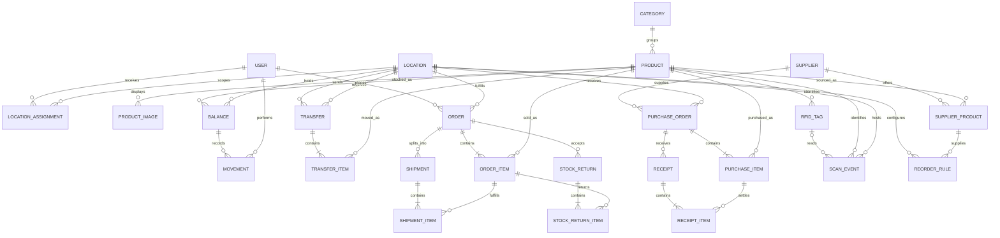
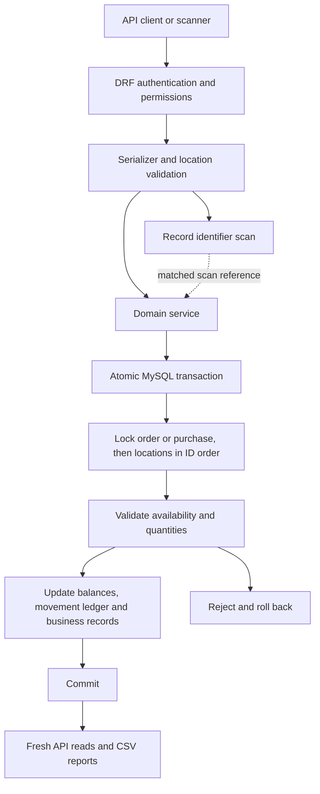

# StockSmart backend architecture

The location model represents both stores and warehouses. Managers receive individual location assignments. Product barcodes live on the product as optional unique identifiers. RFID tags are independent identifiers associated with products. Low-stock and overdue alerts are derived from current balances and purchase state so reads reflect committed actions.

## Entity relationships

## Request and stock flow

Location locks serialize stock writers at the same location and protect the creation of the first balance. A balance lock guards ledger updates. Multi-location transfers acquire locks in sorted order and apply both movements before committing. Orders and purchase orders also lock their own workflow rows before transitions to make same-key retries safe. Purchase receipt, shipment and scan keys are unique within their business scope. Checkout locks the customer row to serialize checkout retries for the same customer.

Store managers read only records within assignments. Customer orders are scoped by owner. Managers with explicit Django model permissions can write shared catalog metadata. Purchase costs are omitted from customer catalog responses.
